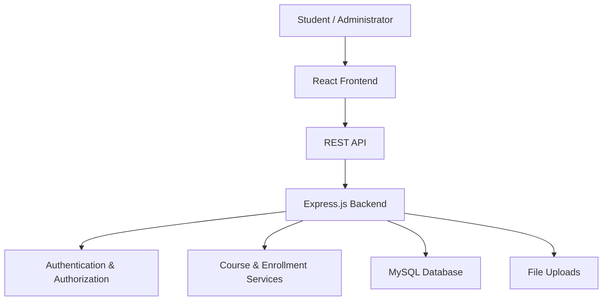

# ⚓ Anchor Solution
### Full-Stack Educational & Vocational Training Platform

<p align="center">
  <strong>Learn Practical Skills. Build Your Future.</strong><br/>
  Bahir Dar, Ethiopia 🇪🇹
</p>

<p align="center">
  <a href="https://anchor-solutions-api.onrender.com">
    
  </a>
  
  
  
</p>

<p align="center">
  <a href="#-overview">Overview</a> •
  <a href="#-training-programs">Programs</a> •
  <a href="#-features">Features</a> •
  <a href="#-technology-stack">Tech Stack</a> •
  <a href="#-project-structure">Structure</a> •
  <a href="#-contact">Contact</a>
</p>

---

## 📌 Overview

**Anchor Solution** is a full-stack educational and vocational training platform designed to connect learners with practical skills, structured learning resources, and career-development opportunities.

Based in Bahir Dar, Ethiopia, the platform aims to make vocational education more accessible through a responsive web experience, organized training programs, and digital learning resources.

**Academic partnerships:** Tis Abay College (ቲስ አባይ ኮሌጅ) and Bahir Dar University (BDU).

> Our objective is to bridge the gap between education and practical skills through accessible, technology-driven learning.

## 🎯 Training Programs

| # | Program | Focus |
|---|---|---|
| 01 | 🎨 Graphics Design | Visual communication and digital design |
| 02 | 🎬 Video Editing | Video production and post-production |
| 03 | 📷 Photography | Photography techniques and visual storytelling |
| 04 | 📈 Digital Marketing | Digital promotion and online audience engagement |
| 05 | 🔧 Mobile & Computer Maintenance | Device troubleshooting and maintenance |
| 06 | 💻 Basic Computer Skills | Essential computer and digital literacy |
| 07 | 🤖 Artificial Intelligence | AI concepts and practical applications |

## ✨ Features

### Learning Experience
- Responsive user interface for desktop, tablet, and mobile.
- Course pages with structured learning content.
- Video lessons and downloadable learning resources.
- Search and accessible navigation.
- Light and dark themes.

### Student Management
- Student registration and authentication.
- Personalized dashboards and learning progress tracking.
- Enrollment management.

### Administration
- Course and student management.
- Role-based access control.
- Database-backed content management.

### Platform Infrastructure
- REST API architecture.
- MySQL database with migration and seed scripts.
- Password hashing and JWT-based authentication.
- File-upload handling.
- Payment integration designed to support secure payment workflows.
- Search-engine optimization and social media integration.

> **Implementation status:** The features above describe the platform's scope. Individual features, payment processing, integrations, and production security must be verified against the current source code and deployment before being considered operational.

## 🛠️ Technology Stack

| Layer | Technologies |
|---|---|
| Frontend | React, JavaScript (JSX), Vite, CSS |
| Backend | Node.js, Express.js |
| Database | MySQL, `mysql2` |
| Authentication | JSON Web Tokens (JWT), `bcryptjs` |
| File Uploads | Multer |
| Styling | CSS, Tailwind CSS |
| Build Tools | Vite, esbuild, TypeScript tooling |
| Deployment | Render |

## 🏗️ Architecture



## 📂 Project Structure

The following is a conceptual overview. Verify the actual repository before treating these paths as exact.

```text
anchor_solutions/
├── client/
│   └── src/
│       ├── components/
│       ├── pages/
│       ├── assets/
│       └── App.jsx
├── database/
│   ├── migrate.js
│   └── seed.js
├── server.ts
├── package.json
├── vite.config.js
├── README.md
└── .gitignore
```

## 🚀 Getting Started

### Prerequisites

- Node.js compatible with the project's Vite version.
- npm.
- A configured MySQL database.

### 1. Clone the repository

```bash
git clone https://github.com/yitbarek-git/anchor_solutions.git
cd anchor_solutions
```

### 2. Install dependencies

```bash
npm install
```

### 3. Configure environment variables

Create a `.env` file using the variables expected by your server and database configuration.

```env
NODE_ENV=development
PORT=3000
```

Add your database credentials and authentication secrets according to your actual configuration. Never commit real credentials or secrets to GitHub.

### 4. Set up the database

After configuring the database:

```bash
npm run db:migrate
npm run db:seed
```

Run the seed command only when appropriate for your database; check whether it inserts demonstration records or could affect existing data.

### 5. Start the application

```bash
npm run dev
```

### 6. Build for production

```bash
npm run build
```

**Note:** Verify the actual environment-variable names, database requirements, Vite configuration, and server startup behavior before following these instructions in production.

## 🌐 Deployment

The project has a Render deployment endpoint:

**API / Service:** https://anchor-solutions-api.onrender.com

The endpoint is a service URL, not necessarily the public URL of a fully configured frontend. Confirm which routes it serves before describing it as the live website.

## 👨‍💻 Team

**Yitbarek** — Developer & Video Editor

Interested in building practical digital products, educational technology, and accessible learning experiences.

## 📬 Contact

📍 **Address:** Meskeret Building, Kebele 04, 4th Floor, Bahir Dar, Ethiopia

📞 **Phone:**
- +251 902 18 44 40
- +251 952 58 77 50
- +251 990 09 21 23
- +251 970 13 57 90

### Follow Anchor Solution

- **Telegram:** [@Anchor_Solutions](https://t.me/Anchor_Solutions)
- **Facebook:** [Anchor Solutions](https://www.facebook.com/)
- **TikTok:** [@anchor_solutions1](https://www.tiktok.com/@anchor_solutions1)

## 🎯 Objective

To develop a reliable and scalable educational platform that promotes vocational education, streamlines student enrollment, and expands access to practical learning opportunities across Ethiopia.

---

<p align="center">
  <strong>Anchor Solution</strong><br/>
  Practical Skills. Accessible Learning. Better Opportunities.
</p>
